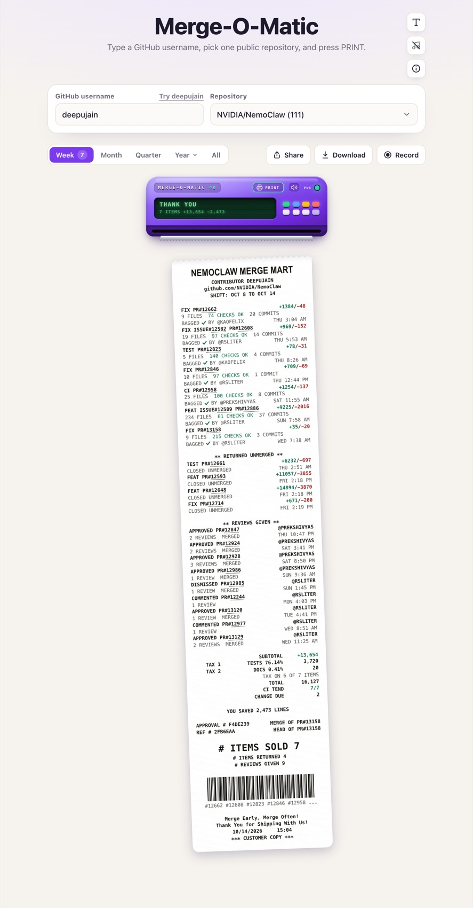
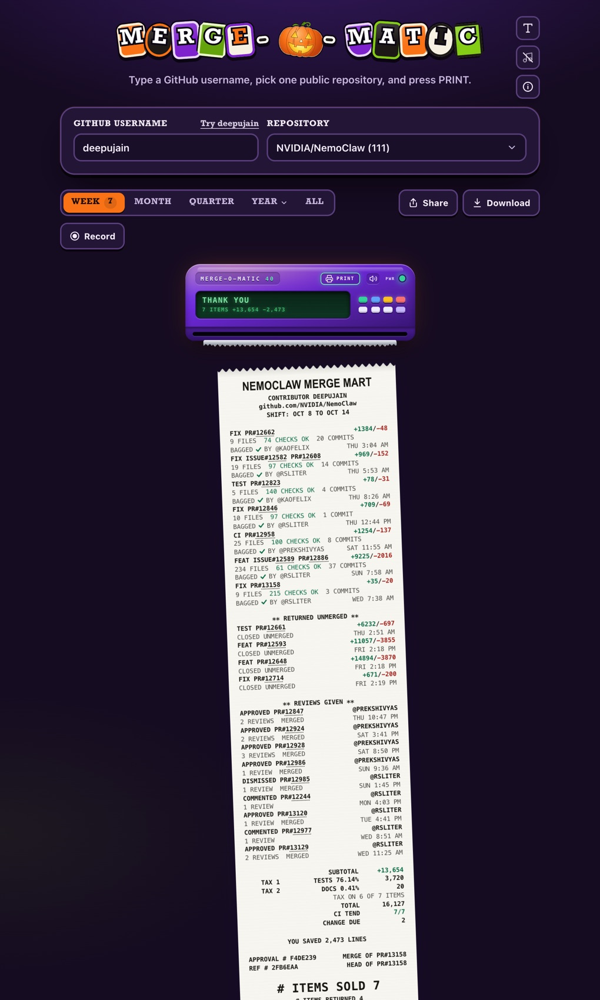
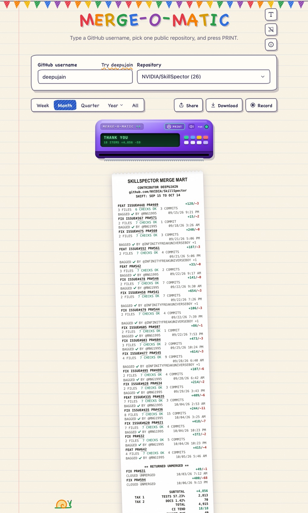

# Merge-O-Matic

**Your merged pull requests, printed as a store receipt.** Type a GitHub username, pick one public repository, and press PRINT. The MERGE-O-MATIC 40 feeds out a thermal receipt that rings up every merged pull request as a line item, with the returns, the reviews you gave, and a total at the bottom.

<p align="center">
  
</p>

**[Try it](https://1xaispark.com/games/merge-o-matic)** · Free and open source (MIT) · Works in any modern browser, on laptops and phones

## What's on the receipt

Every line comes from GitHub's public data for that user and repository.

- **Header.** The repository becomes a store (`NEMOCLAW MERGE MART`), with the contributor and the shift: the week, month, quarter, year, or all time you picked.
- **Line items.** One per merged pull request: its type from a conventional-commit title (`fix:` prints `FIX`, `feat:` prints `FEAT`, a revert prints `RETURN`, anything else `PR`), the issue it closes, the PR number (both link to GitHub), lines added and removed as the price, files, passing checks, commits, the merge time, and `BAGGED ✓ BY @reviewer` for whoever approved it.
- **Returned unmerged.** Pull requests that were closed without being merged.
- **Reviews given.** Reviews you left on other people's pull requests, and whether those merged.
- **Totals.** `SUBTOTAL` is lines added. `TAX 1` and `TAX 2` are the share of changed lines in tests and in docs. `TOTAL` is lines changed, `CI TEND` is how many PRs passed CI, `CHANGE DUE` counts change requests, and `YOU SAVED` counts lines deleted.
- **Footer.** The merge and head commits of the latest PR as approval and reference numbers, `# ITEMS SOLD`, and a barcode of the PR numbers.

## Features

- **A printer with personality.** The receipt feeds out line by line with printer sounds, and you tear it off when it's done. The display shows what's happening: `READY`, `PRINTING 7 ITEMS`, `THANK YOU`.
- **Ranges.** Week, Month, Quarter, Year (this year or any past year), or All.
- **Keep it.** **Download** saves the receipt as a PNG. **Share** opens your device's share sheet. **Record** films the machine printing, with its sound, and saves an MP4 or WebM, drawn in the page with no screen capture.
- **Shareable links.** The username, repository, and range stay in the address, like `?login=octocat&repo=octo-org/hello-world&day=month`.
- **Three styles.** Normal; Halloween, with letter tiles, a pumpkin O, bats and a witch; and Crayon, with hand-drawn letters on lined paper. Each comes in Light, Dark, or Auto, and each has its own music loop, made live with Web Audio and off until you turn it on.

<p align="center">
  
  &nbsp;&nbsp;
  
</p>

## Run it

Requires Node.js 20 or later. There are no dependencies to install.

```sh
git clone https://github.com/deepujain/merge-o-matic.git
cd merge-o-matic
GITHUB_PUBLIC_READ_TOKEN=github_pat_... npm start
```

Then open http://localhost:8040.

Without a key, the page prints clearly labelled demo data (`DEMO DATA. NOT FROM GITHUB.`), so you can try it right away. For real receipts, create a [fine-grained personal access token](https://github.com/settings/personal-access-tokens/new) with **Public repositories (read-only)** access and nothing else. To read public repositories in an organization that enforces SAML SSO, authorize the token for that organization.

| Variable | Default | What it does |
|---|---|---|
| `GITHUB_PUBLIC_READ_TOKEN` | none | The GitHub key for live data. It stays on the server. |
| `PORT` | `8040` | The port to listen on. |
| `NODE_ENV` | none | Set to `production` to turn off demo data: without a key, the page says lookups are resting instead. |
| `TRUST_PROXY` | off | Set to `1` behind a load balancer, so rate limits use the client address from `X-Forwarded-For`. |
| `MOM_SKIP_LOGINS` | none | Comma-separated GitHub logins whose test prints aren't counted, such as your own. |

```sh
npm test    # 82 tests: the receipt, printer, recorder, music, styles, and the server
```

## How it works

- **The page** (`web/`) is plain HTML, CSS, and JavaScript modules, with no framework and no build step. The receipt is a 40-column monospaced grid drawn in HTML for the screen and on a canvas for the PNG and the video.
- **The server** (`server/`) serves the page and five same-origin JSON routes, using Node's built-ins only:
  - `GET /api/fun/merged/repos?login=` lists the public repositories a user has merged into, newest first, with counts.
  - `GET /api/fun/merged?login=&repo=&since=&until=` returns the receipt data for one repository and range.
  - `GET /api/fun/merged/limit` reports how much GitHub capacity is left, as a share and a level only.
  - `POST /api/fun/merged/print` counts a printed receipt.
  - `GET /api/fun/merged/stats` returns the number of receipts printed, in total and today.
- **GitHub** is queried with GraphQL searches (`is:pr is:merged is:public author:… repo:…`), in batches, with retries. Results are cached per process, and the server backs off when the quota runs low. Searches only ever match public repositories.
- **Guards.** The routes answer only their own page, rate-limit each address, and validate every username, repository, and date range before calling GitHub.

## Privacy

- No account and no GitHub sign-in. It reads public data only.
- Lookups and receipts are never stored or logged.
- The print counter keeps counts only. The page sends a random ID with each print, and the server keeps a salted hash of it that changes every day and every month, so visits can't be linked to a person or to each other. IP addresses, user agents, usernames, and repositories are never stored. Nothing is sent at all when the browser has Do Not Track or Global Privacy Control on.
- In this server, counts live in memory and reset when it restarts.

## Project layout

```text
web/
  index.html      The page
  page.js         Form, repository picker, ranges, style switcher, and the calls to the server
  page.css        Page styles: Normal, Halloween, Crayon, light and dark
  style.js        Applies the saved style and appearance before the first paint
  music.js        One generated music loop per style
  stats.js        The anonymous print counter
  kit/            The receipt printer: receipt layout, printer UI, sound, PNG, and video recording
server/
  server.js       Static files and the JSON routes
  lib/            GitHub transport, search and receipt building, key handling, rate limits, usage counts
test/             node:test suites
docs/images/      README screenshots
```

## License

MIT © 2026 Deepak Jain. See [LICENSE](LICENSE).
